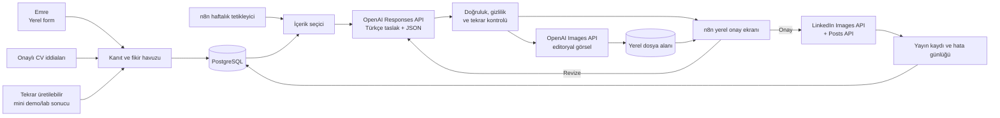

# Yerel LinkedIn İçerik Otomasyonu - Mimari Tasarım

## 1. Amaç ve sınırlar

Bu sistem Emre Çancıoğlu'nun OT, IIoT, endüstriyel yapay zeka, enerji yönetimi,
üretim analitiği ve dijital dönüşüm uzmanlığını haftalık Türkçe LinkedIn
gönderilerine dönüştürür.

- Orkestrasyon, veri tabanı, dosyalar ve onay ekranı Mac üzerinde çalışır.
- Yalnızca OpenAI API ve LinkedIn API için dışarıya bağlantı kurulur.
- ChatGPT Work/Codex sistemi kurmak ve bakımını yapmak için kullanılır; haftalık
  çalışma ChatGPT Work'e bağlı değildir.
- Sistem yeni bir başarı veya sonuç uydurmaz. Gerçek çalışma, tekrar
  üretilebilir mini deney, açıkça etiketlenmiş demo veya uzman görüşü üretir.
- Şirket adı, tesis verisi, ekran görüntüsü, müşteri bilgisi veya gizli metrik
  ancak açık onayla kullanılabilir.

## 2. Mevcut durum

İncelenen Mac:

- MacBook Air, Apple M4, 10 çekirdek, 16 GB RAM
- macOS 26.5.1
- Docker Engine 29.1.3 ve Docker Compose 5.0.0
- Çalışan `n8nio/n8n:latest` container'ı, n8n 2.3.4
- Kalıcı `n8n_data` volume'u var
- Mevcut container'da restart policy yok, CPU/RAM sınırı yok ve harici veri
  tabanı ayarı olmadığı için varsayılan yerel veri tabanı kullanılıyor

M4/16 GB, haftada bir içerik için fazlasıyla yeterlidir. Queue mode, Redis ve
ayrı worker bu ölçekte gereksizdir. İlk üretim mimarisi tek n8n instance +
PostgreSQL olmalıdır.

## 3. Önerilen topoloji



## 4. Docker servisleri

### Zorunlu

1. `n8n`
   - İş akışları, zamanlayıcı, yerel onay formu ve API çağrıları.
   - `localhost:5678` üzerinde tutulur; internete doğrudan açılmaz.
   - Sabit bir image etiketi kullanılır; `latest` kullanılmaz.
   - `restart: unless-stopped` eklenir.
   - Şifreleme anahtarı `.env` içinde tutulur ve yedeklenir.

2. `postgres`
   - İçerik fikirleri, doğrulanmış iddialar, taslaklar, onaylar, yayın kayıtları
     ve maliyet/usage verisi.
   - Yalnızca Docker iç ağına açılır.

3. `content_data` yerel volume/bind mount
   - Üretilmiş görseller, onay önizlemeleri ve JSON çıktıları.
   - Önerilen düzen:

```text
content-data/
  brand/
  evidence/
  generated/YYYY/MM/
  approved/YYYY/MM/
  archive/YYYY/MM/
```

### Şimdilik eklenmemeli

- Redis/queue worker: Haftalık hacimde fayda sağlamaz.
- Qdrant/vector DB: CV ve birkaç yüz içerik kartı için PostgreSQL yeterlidir.
- MinIO: Tek Mac üzerinde normal dosya sistemi daha basittir.
- Ollama: Metin kalitesi için OpenAI API kullanılacağı için ilk sürümde gereksizdir.

## 5. Veri modeli

### `evidence_items`

Her gönderinin dayandığı gerçek bilgi.

| Alan | Örnek |
|---|---|
| `id` | UUID |
| `kind` | `real_work`, `lab_demo`, `lesson`, `opinion`, `publication` |
| `title` | Basınçlı hava anomali tespiti |
| `situation` | Kaçakların geç fark edilmesi |
| `action` | MES, SAP ve kompresör verisinin birleştirilmesi |
| `result` | Onaylı metrik veya `null` |
| `source_ref` | CV maddesi, yayın DOI/URL veya yerel dosya |
| `proof_level` | `verified`, `self_reported`, `demo`, `idea` |
| `confidentiality` | `public`, `anonymize`, `private` |
| `approved_claims` | Kullanılmasına izin verilen cümleler |
| `status` | `new`, `used`, `blocked` |

### `content_posts`

`topic`, `pillar`, `hook`, `body`, `cta`, `hashtags`, `image_prompt`,
`image_path`, `claim_map`, `risk_flags`, `approval_status`, `scheduled_at`,
`linkedin_post_urn`, `model_ids`, `token_usage`, `created_at`.

### Zorunlu `claim_map`

Taslakta bulunan her ölçülebilir veya geçmiş zamanlı iddia, kaynak id ile
eşleşmelidir:

```json
{
  "claim": "Raporlama süresini yüzde 60 hızlandırdık.",
  "evidence_id": "...",
  "allowed": true
}
```

Eşleşmeyen iddia varsa gönderi otomatik olarak `blocked` olur.

## 6. n8n iş akışları

### WF-01 - Kanıt/Fikir Girişi

`Form Trigger -> Normalize -> Hassas Veri Kontrolü -> PostgreSQL Insert`

Yerel form alanları:

- Bu hafta ne öğrendim veya neyi denedim?
- Problem neydi?
- Ne yaptım?
- Sonuç ne oldu? Metrik varsa kaynağı nedir?
- Gerçek saha çalışması mı, mini demo mu, görüş mü?
- Şirket/kişi/tesis adı kullanılabilir mi?
- Ekran görüntüsü veya kaynak dosyası var mı?

Form 2-3 dakikada doldurulacak kadar kısa olmalıdır. Boş hafta olursa sistem
CV'deki onaylı bir iddiayı öğretici bir gönderiye veya yerel bir mini demoya
dönüştürür; yeni başarı uydurmaz.

### WF-02 - Haftalık Taslak Üretimi

`Schedule Trigger -> Kullanılmamış Kanıt Seç -> Tekrar Kontrolü -> OpenAI
Responses API -> JSON Schema Validate -> PostgreSQL Insert`

Önerilen zaman: Her pazartesi 08:30 taslak oluşturma. Model çıktısı serbest metin
değil, Structured Outputs ile şu alanları döndürür:

```json
{
  "pillar": "OT_VERI_MIMARISI",
  "hook": "...",
  "body": "...",
  "cta": "...",
  "hashtags": ["#Endustri40"],
  "claims": [],
  "image_brief": "...",
  "risk_flags": []
}
```

Metin ilk sürümde 900-1.500 karakter, kısa paragraflı, teknik ama anlaşılır ve
en fazla 3-5 hashtag olacak şekilde sınırlandırılır.

### WF-03 - Doğruluk ve Gizlilik Kapısı

`Load Evidence -> Deterministic Rules -> LLM Reviewer -> IF Pass/Block`

Deterministik kurallar:

- Geçmiş zamanlı her başarı `claim_map` içinde olmalı.
- Sayı, yüzde, para, süre, ödül, müşteri ve şirket adı kaynak gerektirir.
- `private` kayıt metne veya görsele giremez.
- `anonymize` kayıtlarında tesis, hat, müşteri ve kişi adları temizlenir.
- “Hayata geçirdim/kurduk/sonuç aldık” yalnızca `real_work + verified` için.
- `lab_demo` için “yerel bir demo/simülasyon kurdum” ifadesi zorunlu.
- Kanıtı olmayan fikirlerde gelecek/öneri dili kullanılır.
- Önceki 12 gönderiyle konu ve açılış benzerliği kontrol edilir.

İkinci model yalnızca değerlendirme yapar; içeriğe yeni iddia ekleyemez.

### WF-04 - Görsel Üretimi

`Approved Draft -> Image Prompt Builder -> OpenAI Images API -> Binary File ->
Metadata Save`

Görsel standardı:

- 1200 x 1200 PNG/JPEG, 1:1. Alternatif olarak 1200 x 627, 1.91:1.
- Koyu lacivert + elektrik mavisi + beyaz kişisel renk sistemi.
- Endüstriyel veri akışı, sensör, dashboard, UNS, enerji veya AI temasını
  anlatan temiz editoryal illüstrasyon.
- Gerçek fabrika fotoğrafı izlenimi, sahte ekran görüntüsü, şirket logosu,
  müşteri logosu ve okunması gereken uzun AI metni yok.
- Görseldeki başlık gerekiyorsa AI ile değil, daha sonraki yerel şablon katmanı
  ile yazılır.

Tek görsel üretimi için Images API yeterlidir. Çok turlu görsel düzenleme
istenirse Responses API image tool kullanılabilir.

### WF-05 - Yerel Onay

`Create Preview -> Wait/Webhook -> Approve | Revise | Reject`

Onay ekranında birlikte gösterilir:

- LinkedIn metni
- Görsel
- İddia-kaynak listesi
- Gizlilik/risk bayrakları
- Tahmini API kullanımı
- `Onayla`, `Revize et`, `Reddet` seçenekleri

İlk 12 gönderide insan onayı zorunludur. Sonrasında yalnızca düşük riskli
`lesson` ve `opinion` türlerinde otomatik yayın ayrıca değerlendirilebilir.

### WF-06 - LinkedIn Yayını

`Approved -> OAuth Token -> Initialize Image Upload -> PUT Binary -> Create Post
-> Save Post URN -> Notify`

- Kişisel profil için OAuth 2.0 ve `w_member_social` gerekir.
- Yeni entegrasyon `/rest/images` ve `/rest/posts` uçlarını kullanır.
- `Linkedin-Version` güncel desteklenen sürüme ayarlanır ve düzenli gözden
  geçirilir.
- Hata durumunda aynı gönderiyi tekrar üretmek yerine exponential backoff ve
  idempotency kontrolü uygulanır.
- OAuth veya LinkedIn uygulama erişimi hazır değilse sistem “yayına hazır”
  klasörü oluşturup manuel gönderim modunda çalışabilir.

### WF-07 - Operasyon, Yedek ve Sağlık

- Günlük: n8n sağlık kontrolü ve başarısız execution bildirimi.
- Haftalık: PostgreSQL dump + `content-data` arşivi.
- Aylık: n8n güvenlik denetimi, workflow export ve restore testi.
- Execution verisi için saklama süresi; gereksiz binary veriyi otomatik temizleme.
- API anahtarları n8n credentials/.env içinde; workflow JSON'unda bulunmaz.

LinkedIn kişisel gönderi performansını API ile otomatik okumak için gereken
`r_member_social` kısıtlı olabilir. Bu izin alınamazsa haftalık gösterim,
reaksiyon, yorum ve profil görüntüleme değerleri yerel forma manuel girilir.

## 7. İçerik stratejisi

### Uzmanlık sütunları

1. OT veri mimarisi: OPC UA, MQTT, UNS, ISA-95, edge-to-cloud.
2. Endüstriyel AI: kestirimci bakım, anomali tespiti, bilgisayarlı görü.
3. Enerji ve sürdürülebilirlik: ISO 50001, basınçlı hava, tahminleme, karbon.
4. Üretimde GenAI: RAG, n8n, ajanlar, güvenli kurumsal kullanım.
5. OT siber güvenlik: Purdue, VLAN, NAT, IEC 62443.
6. Teknik liderlik: küçük ekiplerle ölçekleme, AI elçileri, proje dersleri.

### Dört haftalık döngü

| Hafta | Biçim | Örnek |
|---|---|---|
| 1 | Gerçek çalışma/retrospektif | “OPC UA alarm platformunda öğrendiğim 3 şey” |
| 2 | Mini demo/lab | “Yerel MQTT verisinde basit anomali tespiti deneyi” |
| 3 | Teknik öğretici | “UNS ile klasik point-to-point entegrasyon farkı” |
| 4 | Görüş/çerçeve | “Üretimde GenAI projesi seçerken kullandığım kontrol listesi” |

### Gönderi şablonu

1. Kısa ve somut açılış.
2. Problemin bağlamı.
3. Uygulanan yaklaşım veya açıkça etiketlenmiş demo.
4. Doğrulanmış sonuç ya da öğrenilen ders.
5. Okuyucuya uygulanabilir 2-4 madde.
6. Tek bir gerçek soru/CTA.

Kaçınılacak dil: aşırı emoji, “devrim yarattık”, kaynaklanmamış yüzdeler,
“her şeyi AI çözdü”, yapay kurumsal övgü ve sahte müşteri/tesis hikayeleri.

## 8. Model ve API seçimi

- Metin: OpenAI Responses API + Structured Outputs. Başlangıç için maliyet/kalite
  dengeli küçük/orta model; son kalite kontrolünde daha güçlü model opsiyonel.
- Görsel: hızlı haftalık üretim için `gpt-image-2.5-flare`; hassas marka
  düzenlemeleri için `gpt-image-2.5-sunburst`.
- Model kimlikleri üretimde snapshot'a sabitlenir; yükseltme önce test veri
  kümesinde denenir.
- Her istekte model, token kullanımı, latency ve yaklaşık maliyet kaydedilir.

OpenAI kaynakları:

- https://developers.openai.com/api/docs/guides/text
- https://developers.openai.com/api/docs/guides/structured-outputs
- https://developers.openai.com/api/docs/guides/image-generation

LinkedIn kaynakları:

- https://learn.microsoft.com/en-us/linkedin/shared/authentication/getting-access
- https://learn.microsoft.com/en-us/linkedin/marketing/community-management/shares/images-api
- https://learn.microsoft.com/en-us/linkedin/marketing/community-management/shares/posts-api

## 9. Güvenlik ve gizlilik

- n8n yalnızca `127.0.0.1` üzerinde dinler; uzaktan erişim gerekiyorsa VPN/Tailscale
  ve TLS kullanılır.
- OpenAI'ye ham CV'nin tamamı her çağrıda gönderilmez; yalnızca ilgili, onaylı
  kanıt kartı gönderilir.
- Fabrika ekran görüntülerinde EXIF, seri numarası, IP, makine/hat adı, çalışan
  yüzü ve pano bilgileri temizlenir.
- Prompt injection'a karşı web içeriği talimat değil veri olarak işaretlenir.
- OpenAI ve LinkedIn anahtarları Git'e eklenmez.
- Mevcut `n8n_data` volume'u yedeklenmeden container değiştirilmez.

## 10. Kurulum sırası

### Faz 1 - Güvenli temel

1. Mevcut n8n volume ve workflow yedeği.
2. `latest` yerine sabit sürümlü Compose kurulumu.
3. PostgreSQL'e geçiş, encryption key ve restart policy.
4. Yerel dosya alanı ve yedekleme.

### Faz 2 - İçerik motoru

1. CV'den yalnızca yayınlanabilir iddiaların kanıt bankasına aktarılması.
2. WF-01, WF-02 ve WF-03.
3. 10 örnek kayıtla halüsinasyon, gizlilik ve Türkçe üslup testleri.

### Faz 3 - Görsel ve onay

1. Kişisel renk/şablon seti.
2. WF-04 ve WF-05.
3. Mobil/masaüstü LinkedIn önizleme kontrolü.

### Faz 4 - Yayın

1. LinkedIn Developer App ve OAuth.
2. Önce test metni, sonra görselli test.
3. WF-06'yı haftalık programa bağlama.
4. İlk 12 gönderi tamamen insan onaylı.

## 11. Başarı ölçütleri

İlk 8 hafta için sistem hedefleri:

- Haftada 1, ayda 4 kaliteli gönderi.
- Onay öncesi ortalama düzenleme süresinin 10 dakikanın altına inmesi.
- Kaynaksız sayısal iddia: 0.
- Gizli bilgi olayı: 0.
- Aynı konu/açılış tekrarı: en fazla yüzde 10.
- Gönderi başına profil görüntüleme, nitelikli bağlantı isteği ve gerçek teknik
  yorumların manuel/otomatik kaydı.

Beğeni tek başına ana KPI değildir. Asıl hedef, OT ve endüstriyel AI alanında
doğru kişilerden profil görüntüleme, nitelikli konuşma ve davet üretmektir.
