<p align="center">
  <picture>
    <source media="(prefers-color-scheme: dark)" srcset="docs/readme/hero-dark.svg" />
    <source media="(prefers-color-scheme: light)" srcset="docs/readme/hero-light.svg" />
    
  </picture>
</p>

<p align="center">
  
  
  
</p>

<p align="center">
  
  
  
  
  
  
  
  
</p>

This is a self-hosted pipeline that turns my real work in OT, IIoT, industrial AI, energy management and digital transformation into **one Turkish LinkedIn post a week**. n8n picks a piece of evidence and OpenAI drafts the post and its visual. A claim gate checks every statement against the evidence. I approve or regenerate the post from Telegram, and the approved post is published through the LinkedIn API.

Its main rule is **no invented results**. Every number or past-tense achievement in a post has to map to an approved evidence item, or the post is blocked.

## ✨ Principles

<p align="center">
  <picture>
    <source media="(prefers-color-scheme: dark)" srcset="docs/readme/features-dark.svg" />
    <source media="(prefers-color-scheme: light)" srcset="docs/readme/features-light.svg" />
    
  </picture>
</p>

## 🔁 How a post is made

<p align="center">
  <picture>
    <source media="(prefers-color-scheme: dark)" srcset="docs/readme/workflow-dark.svg" />
    <source media="(prefers-color-scheme: light)" srcset="docs/readme/workflow-light.svg" />
    
  </picture>
</p>

| Workflow | Trigger | What it does |
|---|---|---|
| [`01` Evidence intake](workflows/01-evidence-intake.json) | n8n form | A 2–3 minute form for adding real work, mini demos, lessons and opinions to the evidence bank, with confidentiality settings. |
| [`02` Weekly draft](workflows/02-weekly-draft.json) | Mon 08:30 | Picks unused evidence, asks OpenAI for a draft as structured JSON ([schema](schemas/linkedin-post.schema.json)), then runs the claim and privacy review. |
| [`03` Image generation](workflows/03-image-generation.json) | every 2 min | Generates the visual for new drafts. The [image renderer](image-renderer/server.py) then adds the title, layout and brand signature. |
| [`04` Local review](workflows/04-local-review.json) | n8n form | A local preview and approval form, used as the fallback to Telegram. |
| [`05` Weekly scheduling](workflows/05-weekly-scheduling.json) | Mon 09:00 | Puts the next approved post into this week's publishing slot. |
| [`06` LinkedIn publishing](workflows/06-linkedin-publishing.json) | every 15 min | Uploads the image, creates the post and stores the post URN. |
| [`07` Telegram regeneration](workflows/07-telegram-regeneration.json) | every minute | Picks up Telegram button presses and regenerates the text, the image or both. |
| [`08` Technology radar](workflows/08-technology-radar.json) | daily 07:30 | Collects CISA KEV, Siemens ProductCERT, OpenAI, Microsoft Security and AWS ML items and scores how relevant and urgent each one is. |

## 🗓 The weekly rhythm

<p align="center">
  <picture>
    <source media="(prefers-color-scheme: dark)" srcset="docs/readme/schedule-dark.svg" />
    <source media="(prefers-color-scheme: light)" srcset="docs/readme/schedule-light.svg" />
    
  </picture>
</p>

## 🐳 Services

Everything is defined in [`compose.yaml`](compose.yaml), and every port is bound to `127.0.0.1`.

| Service | Role |
|---|---|
| `n8n` | Workflows, schedules, forms and API calls. Runs on `https://localhost:5678` with PostgreSQL as its database. |
| `postgres` | Evidence bank, drafts, claim maps, approvals, publishing log and API usage. The schema is in [`db/init/`](db/init). |
| `image-renderer` | A Python/Pillow service that lays the post title, icons and the `emrecancioglu.com` signature over the generated image in the site's colors. |
| `radar-collector` | A Node service that fetches and scores the security and AI feeds for the technology radar. |
| `telegram-review-bot` | Sends each draft with its visual to Telegram, with approve, regenerate and reject buttons. Enabled with `--profile telegram`. |
| `content-preview` | nginx serving generated content at `http://localhost:8080` for quick previews. |

## 📁 Repository layout

```
workflows/        n8n workflow exports (01–08)
prompts/          content generator, claim reviewer and image prompts
schemas/          JSON schema for the structured post output
db/init/          PostgreSQL schema + seed evidence (run on first start)
image-renderer/   Pillow service that brands the generated images
radar-collector/  feed collector for the technology radar
telegram-bot/     Telegram review bot
n8n-overrides/    patched LinkedIn credential/node files mounted into n8n
brand/            profile, content pillars and logo
scripts/          setup, import, backup and README-artwork scripts
content-data/     generated/approved content (git-ignored)
```

## 🚀 Getting started

1. Create `.env` from the example and fill in the values. Keep `.env` out of Git; it is already ignored.

   ```bash
   cp .env.example .env
   ```

2. Put a locally trusted certificate in `tls/` as `localhost-cert.pem` and `localhost-key.pem` (for example with `mkcert localhost`). Then start the stack:

   ```bash
   docker compose up -d --build
   ```

3. Import the workflows. Then open n8n and assign the PostgreSQL, OpenAI and LinkedIn credentials:

   ```bash
   ./scripts/import-workflows.sh
   ```

4. Optionally set up the Telegram review bot. The script asks for the BotFather token without echoing it and saves it as a Docker secret. Then start the bot:

   ```bash
   ./scripts/setup-telegram.sh
   ```

   ```bash
   docker compose --profile telegram up -d
   ```

5. Back up the database, content and workflows:

   ```bash
   ./scripts/backup.sh
   ```

> 🔐 API keys live in `.env`, n8n credentials or `.secrets/`. They are never stored in workflow JSON or in this repo.

## 🧭 Content strategy

Posts rotate through six pillars: **OT data architecture, industrial AI, energy & sustainability, GenAI in manufacturing, OT cybersecurity and technical leadership**. A four-week cycle alternates between a real-work retrospective, a mini lab demo, a technical explainer and an opinion piece. The full design, covering the data model, guardrails and rollout phases, is in [ARCHITECTURE_TR.md](ARCHITECTURE_TR.md) (Turkish).

<p align="center">
  <picture>
    <source media="(prefers-color-scheme: dark)" srcset="docs/readme/footer-dark.svg" />
    <source media="(prefers-color-scheme: light)" srcset="docs/readme/footer-light.svg" />
    
  </picture>
</p>

<sub>README artwork and badges are generated by <a href="scripts/build_readme_assets.py"><code>scripts/build_readme_assets.py</code></a>. To change the text, edit it there and run <code>python3 scripts/build_readme_assets.py</code>.</sub>
